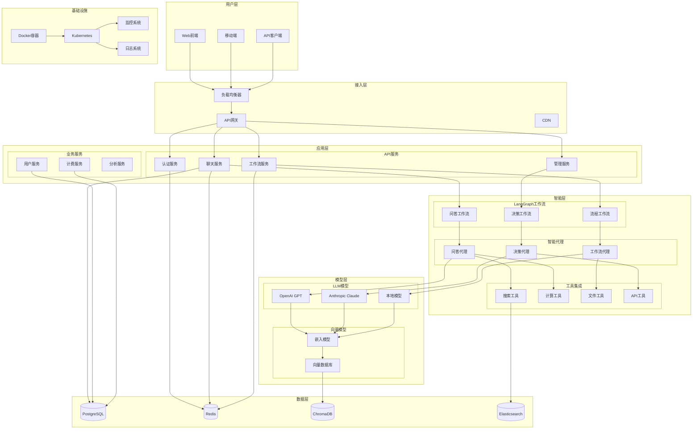
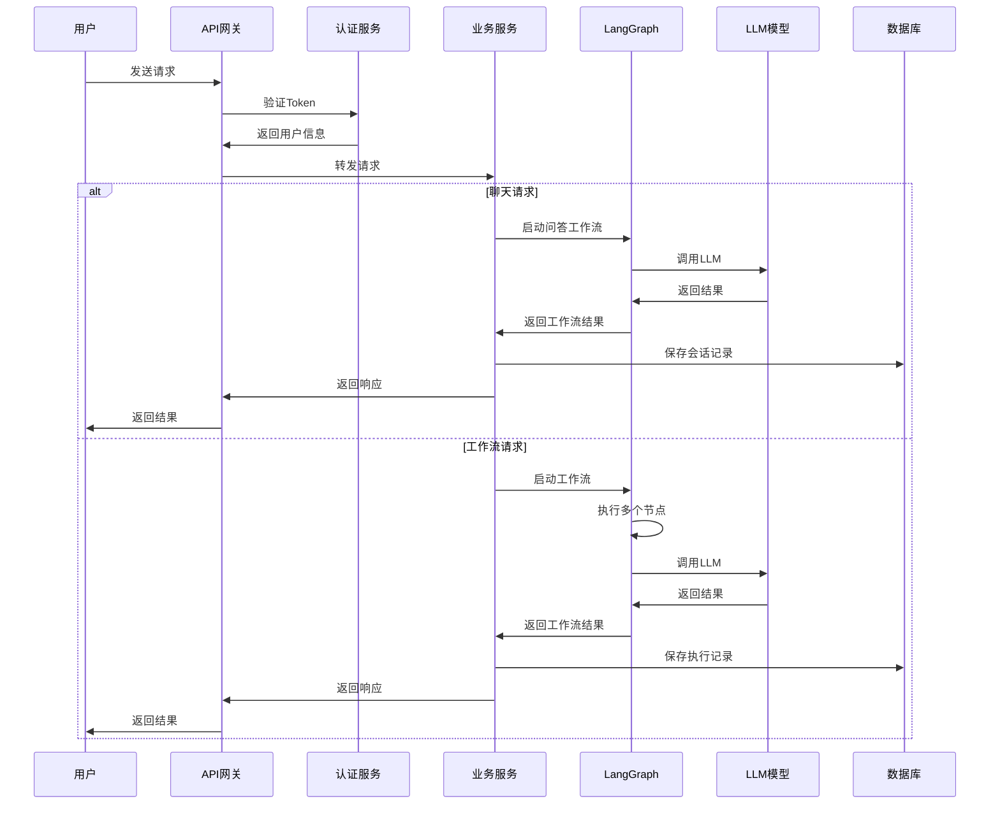
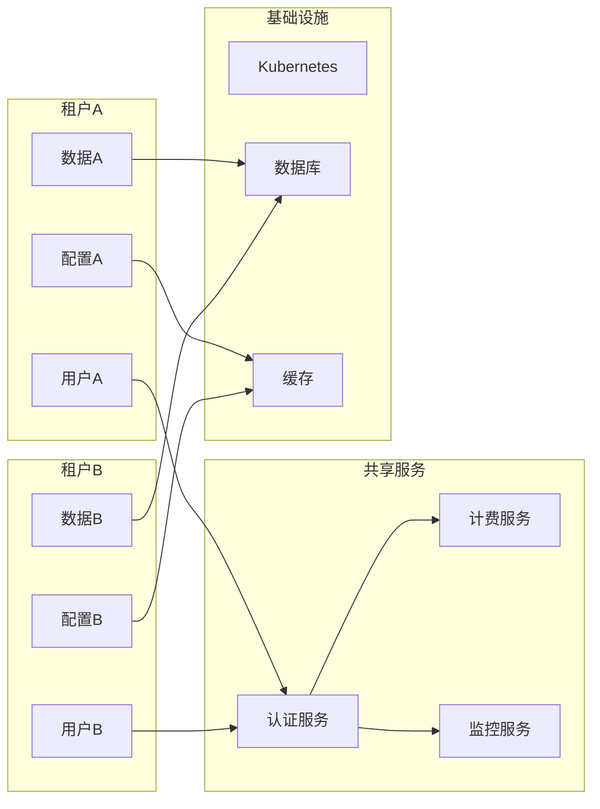
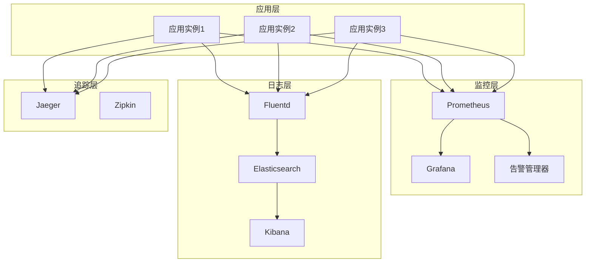
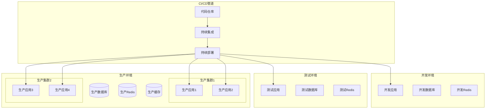
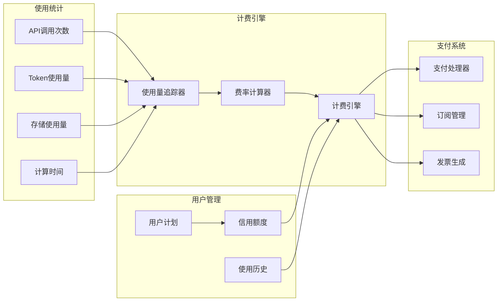

# LangGraph 商业化项目架构图

## 🏗️ 系统架构概览

## 🔄 数据流架构

## 🏢 多租户架构

## 📊 监控架构

## 🚀 部署架构

## 💰 计费架构

这些架构图展示了LangGraph商业化项目的完整技术架构，包括：

1. **系统架构概览** - 展示各层组件的关系
2. **数据流架构** - 说明请求处理的时序流程
3. **多租户架构** - 展示租户隔离和共享服务
4. **监控架构** - 展示完整的可观测性体系
5. **部署架构** - 展示从开发到生产的部署流程
6. **计费架构** - 展示商业化计费系统的设计

这个架构设计确保了系统的可扩展性、可维护性和商业化运营能力。 